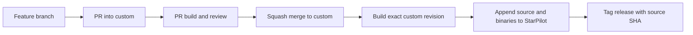

# Development and publishing workflow

This guide applies to `techfoundrynz/StarPilot`. Develop on branches based on
`custom`; CI publishes complete, tested device releases to `StarPilot`.
The comma installer address remains **`techfoundrynz/StarPilot`**.

## Branch responsibilities

| Branch or ref | Contents | How it changes |
| --- | --- | --- |
| `custom` | Upstream source plus our focused commits; the default branch | Feature PRs are squash-merged here; accepted upstream updates rebase it |
| `StarPilot` | A complete source snapshot and its matching device binaries | CI appends a release commit after a successful accepted-source build |
| `upstream-base` | The upstream commit underlying our accepted source stack | Updated together with `custom` when accepting an upstream rebase |
| `upstream/StarPilot` | Local tracking ref for `firestar5683/StarPilot` | `git fetch upstream` |
| Feature branches | Work in progress based on `custom` | Developer commits; removed after merging |
| `updates/upstream-<run>-<attempt>` | A proposed upstream rebase | The **Update upstream** workflow prepares it for review |

`upstream-base` is required update bookkeeping, not a disposable backup branch.
Do not develop on `StarPilot`, merge feature PRs into it, or commit build output
to `custom`. Files already tracked by upstream remain in the source tree,
including upstream's binaries; our publication commits stay on the install branch.



## Start a feature

Use the [one-time remote and rerere setup](upstream-updates.md#one-time-local-setup)
for a new checkout. The current maintainer checkout already has it configured.
Run commands from the repository root, with unrelated work committed or saved.

```sh
git fetch origin --prune
git switch -c feature/my-change origin/custom
```

Keep each change focused. Separate vehicle behavior, pet UI, and CI infrastructure
into independent changes where possible. Prefer custom modules with small edits
to upstream integration points, and avoid unrelated formatting.

Run checks appropriate to the change. Stage specific files, inspect the staged
diff, and commit. For example, a documentation-only change can use:

```sh
git add docs/how-to/development-workflow.md
git diff --cached --check
git diff --cached
git commit -m "Clarify the development workflow"
git push -u origin feature/my-change
gh pr create --repo techfoundrynz/StarPilot --base custom --head feature/my-change
```

Use the relevant paths and commit message for your feature. Describe the problem,
resulting behavior, and verification in the PR. Wait for its device build and
review before using **Squash and merge**. This keeps development fixups out of the
long-lived source stack. GitHub is configured to offer squash merging for this fork.

**Merging into `custom` authorizes automatic publication once its build succeeds.**
There is no additional manual release gate. A maintainer's direct push to `custom`
has the same build-and-publish behavior.

## What runs, and what publishes

| Action | Device build | Publishes to `StarPilot` |
| --- | --- | --- |
| Push to a feature branch without a PR | No automatic build | No |
| Open or update a PR targeting `custom` | Yes, using GitHub's PR merge revision | No |
| Push or squash-merge into `custom` | Yes, using that exact source revision | Yes, if successful and still current |
| Manually run **Compile StarPilot** on `custom` | Yes | Yes, if successful and still current |
| Manually run **Compile StarPilot** on another branch | Yes | No |
| Prepare an upstream update | Yes if a new, conflict-free candidate exists | No |
| Accept a successful upstream candidate | Reuses the candidate's verified artifact | Yes, after guarded source promotion |
| CI pushes a release to `StarPilot` | No new build | Already published |

The publication job checks that the source is still the current `custom` tip.
Superseded builds do not publish. It validates the artifact's source SHA, checksum,
required binary paths, and architecture before constructing a release snapshot.
The snapshot's parent is the previous install commit; source rebases do not merge
old development history back into the install branch.

The release commit and annotated `device-<full-source-SHA>` tag are pushed
atomically. The commit message and tag record `Source-Commit: <SHA>`.
Rerunning publication for an already published source succeeds without adding a
duplicate release. Preserve the current `device-*` tag: the publisher uses it to
recognize that source as already released.

For build prerequisites, binary artifacts, and runtime limitations, see
[Device CI](device-ci.md) and [Local device builds](laptop-device-build.md).
A completed build does not itself update a connected device or establish that a
vehicle-specific change works on the car.

## Check a release or run a build manually

Open [Compile StarPilot](https://github.com/techfoundrynz/StarPilot/actions/workflows/compile_starpilot.yaml)
to inspect the latest run. For a manual build, select **Run workflow**, choose the
branch, and select the compiler job count. The CLI equivalent for accepted source is:

```sh
gh workflow run compile_starpilot.yaml --repo techfoundrynz/StarPilot --ref custom
gh run list --repo techfoundrynz/StarPilot --workflow compile_starpilot.yaml --branch custom
```

Wait for both the build and publication jobs. Then inspect the published source:

```sh
git fetch origin
git log -1 --format=%B origin/StarPilot
git rev-parse origin/custom
```

The release's `Source-Commit` should match the source revision you intended to
publish. The two branch tips themselves have different SHAs because the release
has its own commit and history. A source branch can be ahead of the install branch
while a build is pending or has failed.

## Bring in upstream changes

Run [Update upstream](https://github.com/techfoundrynz/StarPilot/actions/workflows/update_upstream.yaml)
on **custom**, leaving **accept_run** blank. Review the candidate, upstream changes,
`review.txt` range-diff, and successful device build. To accept, run the same
workflow again on **custom**, entering the preparation run's numeric ID in
**accept_run**. A run reporting that upstream is already current needs no acceptance.

Do not merge a rebased candidate through a normal PR or use GitHub's **Sync fork**
to update `custom`. The dedicated workflow keeps our patch stack linear and
advances `upstream-base` together with it. See [Maintaining the fork](upstream-updates.md)
for stale candidates, local conflict resolution, and updating a checkout after a rebase.

## Failures, recovery, and branch cleanup

| Situation | Next step |
| --- | --- |
| Build fails | Read the uploaded build logs, fix the source on a feature branch, and rebuild. The previous install remains available. |
| Publication fails after a successful ordinary build | Rerun the failed publication job while the source is still current and the artifact exists. If artifacts expired, run **Compile StarPilot** on `custom`. |
| Upstream preparation conflicts or cannot push its candidate | Read the preparation logs and report; use the local rebase procedure. The accepted branches are unchanged. |
| Candidate or accepted source changed during review | Prepare a new candidate instead of bypassing the stale-source checks. |
| Upstream acceptance promoted source but publication failed | Rerun acceptance with the same preparation run ID while that candidate remains current. Keep its branch until publication and any retries finish. |
| A published feature needs reverting | Revert the source change through a PR into `custom`, then let CI build and append a new release. Do not reset the install branch or move an existing release tag. |

After a feature PR is merged and its source is preserved, delete the feature
branch on GitHub and remove the local branch when no local work remains. Squash
merging changes commit ancestry, so inspect local-only commits before forcing
local branch deletion. Use `git fetch origin --prune` to remove stale remote refs.
Delete accepted candidate branches only after publication and retry needs are resolved.

Keep `custom`, `StarPilot`, and `upstream-base`. Backups are tags, not additional
development branches: `source-backup/<run>` preserves the source before an
accepted rebase. Do not remove a backup while it is needed for recovery or review.

## Install-history baseline

The one-time cleanup on 2026-10-17 replaced the fork's setup commits and PR merges
on `StarPilot` with one initial verified release above the accepted upstream base.
The source tree and all binaries stayed byte-for-byte identical. Normal publication
now only appends automatic release commits; force-push and deletion protection
remain enabled on the install branch.

`migration/pre-install-history-cleanup` retains the former install history, and
`migration/pre-source-split` retains the earlier source/publication migration point.
These are recovery references, not instructions to repeat the history rewrite.
